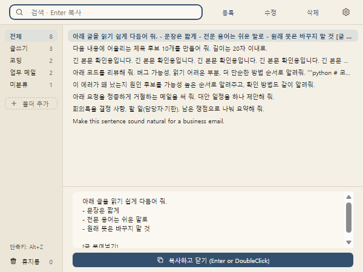

# promptbox

자주 쓰는 텍스트(AI 프롬프트, 인사말, 안내 문구, 주소 등)를 모아 두고, 단축키 한 번으로 찾아 복사하는 Windows 프로그램입니다. 무료입니다.

## 설치

1. [Releases](https://github.com/groundeverymorning-cmd/promptbox/releases/latest)에서 `promptbox-setup-<버전>.exe`를 받아 실행합니다.
2. "Windows에서 PC를 보호했습니다" 창이 뜨면 **추가 정보 → 실행**을 누릅니다. 코드 서명을 하지 않은 무료 프로그램이라 뜨는 창입니다.

관리자 권한이나 Python은 필요 없습니다.

## 사용법

- **Alt+Z**로 창을 열고 검색어를 입력한 뒤, **↑↓**로 고르고 **Enter**를 누르면 복사되고 창이 닫힙니다. **Esc**를 누르면 창만 닫힙니다.
- **등록**(Ctrl+N)을 누르면 뜨는 창에 본문을 붙여넣고 **저장**(Ctrl+S)을 누르면 끝입니다. 제목은 따로 없고, 목록에는 본문이 한 줄로 보입니다. 창 왼쪽 아래 **음성 입력**을 누르면 말한 대로 받아씁니다(Windows 음성 입력).
- 고칠 때는 **수정**(F2)을 누르면 같은 창이 뜹니다. **삭제**(Delete)를 누르면 휴지통으로 갑니다. 왼쪽 맨 아래 **휴지통**을 누르면 휴지통 창이 뜨고, 거기서 **복원**하거나 **휴지통 비우기**로 모두 지울 수 있습니다.
- 목록에서 **더블클릭**해도 복사되고, **오른쪽 클릭**하면 복사·수정·삭제 메뉴가 뜹니다.
- 폴더는 **폴더 추가**로 만들고, 폴더에 마우스를 올리면 보이는 **⋯**(또는 오른쪽 클릭)으로 이름을 바꾸거나 지웁니다. 텍스트를 폴더로 끌어 놓거나 등록·수정 창의 폴더 선택칸에서 고르면 옮겨집니다.
- 오른쪽 위 톱니 버튼(**설정**)에서 단축키를 바꾸고, Windows 시작 시 자동 실행과 복사할 때 효과음을 켜고 끌 수 있습니다.

## 알아 둘 것

- 창을 닫아도 작업 표시줄 오른쪽 트레이에서 계속 기다립니다. 완전히 끄려면 트레이 아이콘을 오른쪽 클릭 → **끝내기**를 누릅니다.
- 새 버전이 나오면 화면 위쪽에 알림이 뜹니다. **업데이트**를 누르면 설치하고 다시 켜집니다.
- 텍스트는 `%APPDATA%\promptbox\`에 저장됩니다. 프로그램을 제거해도 이 폴더는 남아서, 다시 설치하면 그대로 이어서 씁니다.
